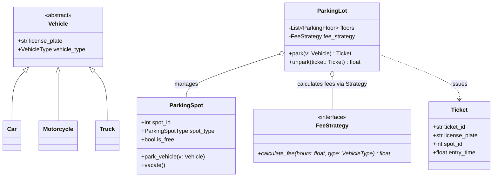

# Parking Lot System

> [!TIP]
> **Interactive Diagram**: Open [diagram.html](diagram.html) in your browser to explore the interactive animated data flow with theme toggles and SVG/image export.

## Overview
The **Parking Lot** is the most iconic machine-coding problem asked across FAANG/Tier-1 interviews.

### Core Functional Requirements
1. Multi-level parking lot with multiple parking floors.
2. Support different vehicle types: Motorcycle, Car, Truck.
3. Support matching parking spot types: Motorcycle Spot, Compact Spot, Large Spot.
4. Issue a ticket upon entry with timestamp and assigned spot.
5. Flexible spot allocation strategy (e.g. Lowest floor / Nearest to entrance).
6. Flexible fee calculation strategy upon exit (Hourly rate based on vehicle type).
7. Real-time availability display board per floor.

## Architecture & Data Flow

## Applied Design Patterns
- **Strategy Pattern**: `FeeStrategy` (Hourly, Flat, Peak pricing) and `AllocationStrategy`.
- **Factory Method**: Vehicle and Spot instantiation.
- **Observer Pattern**: Floor display boards updated when spots are taken or vacated.
