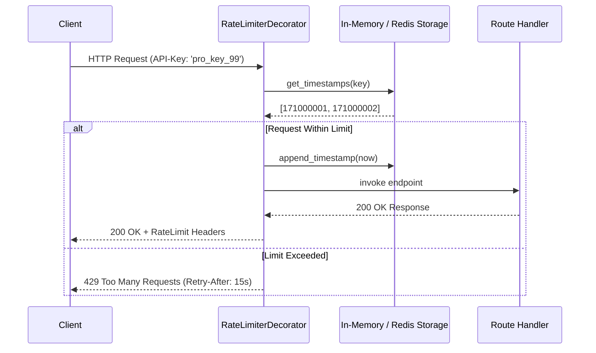

# Rate Limiter Service (Machine Coding)

> [!TIP]
> **Interactive Diagram**: Open [diagram.html](diagram.html) in your browser to explore the interactive animated data flow with theme toggles and SVG/image export.

## Overview
- **Problem**: Design an end-to-end, production-ready Rate Limiter Service that can be applied to backend endpoints (FastAPI / Flask / Django).
- **Core Requirements**:
  1. Configurable limits based on User Tier (e.g., `FREE`: 5 req/min, `PRO`: 100 req/min).
  2. Sliding Window Counter / Log algorithm.
  3. Standard HTTP Rate Limit headers:
     - `X-RateLimit-Limit`
     - `X-RateLimit-Remaining`
     - `X-RateLimit-Reset`
  4. Non-intrusive Python function/route decorator (`@rate_limit`).

## Architecture & Data Flow

## FAANG Interview Significance
- Evaluates both algorithmic precision (sliding window calculation) and software architecture (decorators, middleware integration, header standards).
