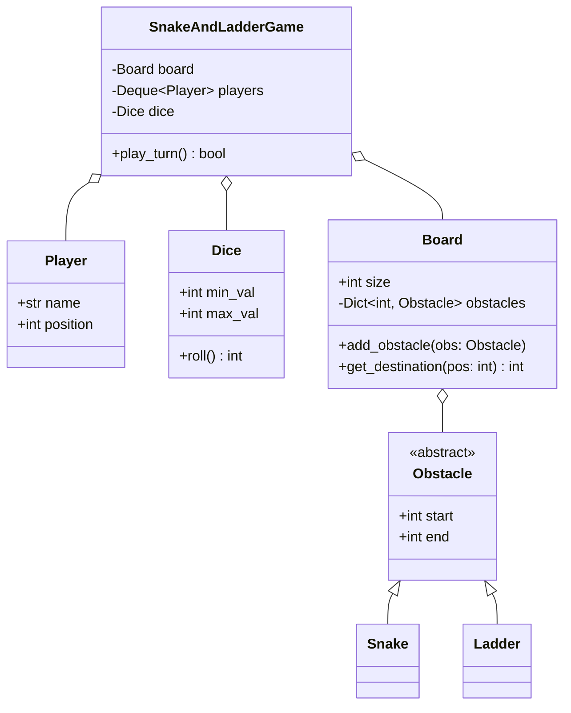

# Snake and Ladder Game (Machine Coding)

> [!TIP]
> **Interactive Diagram**: Open [diagram.html](diagram.html) in your browser to explore the interactive animated data flow with theme toggles and SVG/image export.

## Overview
- **Problem**: Design and implement a multiplayer Snake and Ladder game board.
- **Core Rules**:
  1. Board of size $N \times N$ (default 100 cells, numbered 1 to 100).
  2. Snakes transport players from head down to tail (`head > tail`).
  3. Ladders transport players from bottom up to top (`start < end`).
  4. Players roll a die (1 to 6) in round-robin turns.
  5. The first player to reach the final cell (cell 100) exactly wins.

## Architecture & Data Flow

## FAANG Interview Significance
- Standard interview question testing object modeling, encapsulation, state preservation, and turn-based game loops (same design pattern as Tic-Tac-Toe, Chess, and Connect-4).
